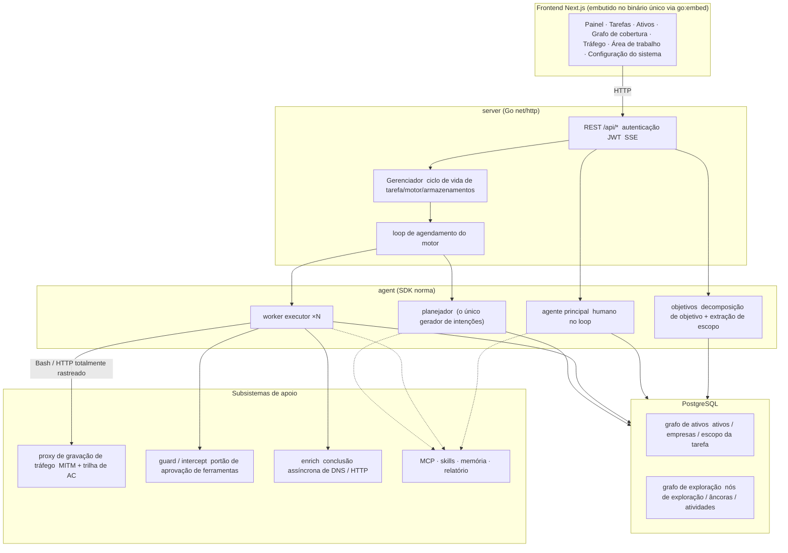
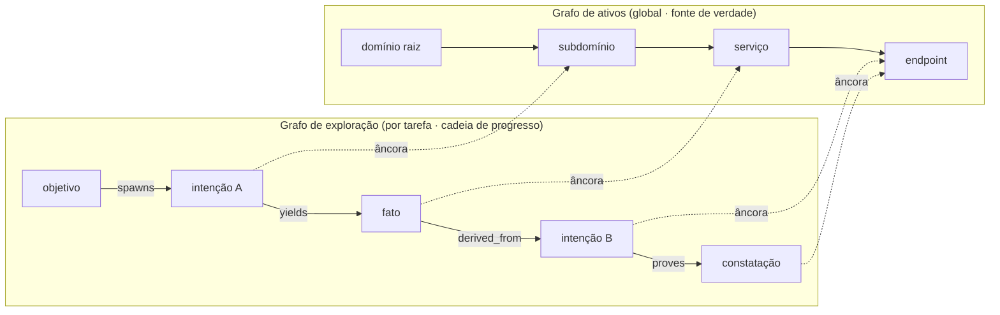
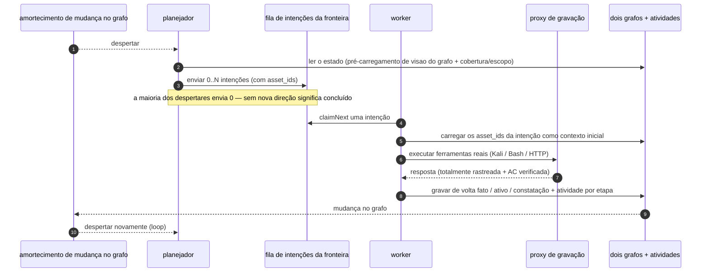
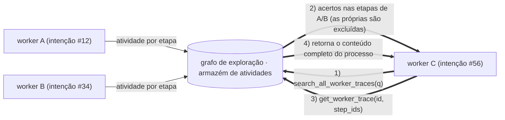
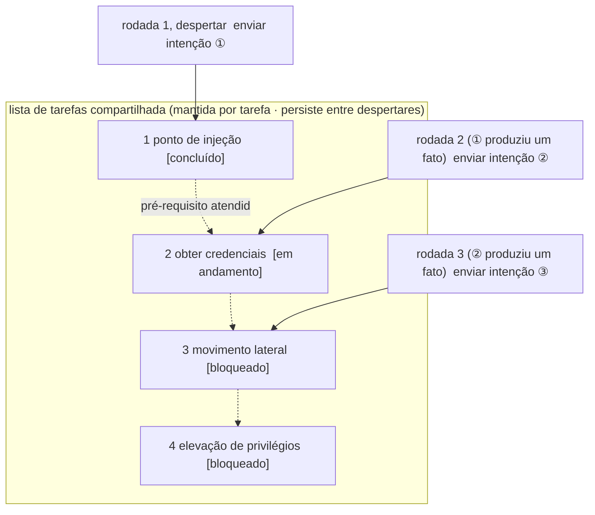

<div align="center">

# ScopeWeaver

Um sistema autônomo de testes de invasão multi-agente baseado em LLM (backend Go + frontend Next.js)

Inglês · [한국어](README.ko.md) · [简体中文](README.zh-Hans.md) · [繁體中文](README.zh-Hant.md) · [日本語](README.ja.md) · [Español](README.es.md)

</div>

---

> **Sobre este projeto.** O ScopeWeaver é um derivado do [Autumn-27/ARTEX](https://github.com/Autumn-27/ARTEX),
> com nova marcação e traduzido para inglês e coreano. Foi construído a partir do commit `160fe13` do projeto original.

Data de modificação: **2026-10-02**. Veja [procedência e alterações](docs/PROVENANCE.md); isto não é uma etiqueta de versão (release tag).

[Status de verificação e limitações conhecidas](docs/VERIFICATION.md).

> O código e a arquitetura derivam do ARTEX. Este derivado independente modifica o
> nome do produto, a interface/mensagens em inglês/coreano, a documentação e os alvos de distribuição. Veja [Procedência e alterações](#procedencia-e-alteracoes)
> para a lista completa do que difere do projeto original, e [Licença e isenção](#licenca-e-isencao)
> para os termos, que não foram alterados (AGPL-3.0).
>
> **Autorização.** Esta é uma ferramenta de testes de segurança. Use-a apenas contra sistemas que você possui ou que estejam
> explicitamente autorizados para teste. As restrições de uso do projeto original continuam valendo — leia-as abaixo.

---

## Idioma

Português brasileiro (`pt`) é o padrão. Selecione inglês, coreano, chinês simplificado (`zh-Hans`),
chinês tradicional (`zh-Hant`), japonês (`ja`), espanhol (`es`) ou português brasileiro (`pt`)
na interface.
`zh` puro, `zh-CN` e `zh-SG` resolvem para chinês simplificado; etiquetas Hans explícitas mantêm seu sistema de escrita mesmo
com região tradicional. `zh-TW`, `zh-HK` e `zh-MO` selecionam chinês tradicional;
etiquetas Hant explícitas mantêm seu sistema de escrita mesmo com região simplificada. Etiquetas regionais de japonês, espanhol e português
resolvem para `ja`, `es` e `pt`. Idiomas sem suporte caem para a preferência seguinte. Veja o
[guia de localização para contribuidores](web/src/i18n/README.md). O padrão persistente do servidor é
o campo `language` nas configurações do sistema; `SCOPEWEAVER_LANGUAGE` (ou `ARTEX_LANGUAGE`) fornece o
fallback por variável de ambiente. O `LANG` do sistema operacional não seleciona o idioma da aplicação.

As requisições dão preferência a `lang`, depois às preferências de `Accept-Language` suportadas, depois ao cookie `scopeweaver_locale`
e depois ao padrão do servidor. Tarefas recém-criadas via HTTP mantêm seu idioma entre filas e
reinicializações; tarefas antigas sem idioma salvo usam o padrão do servidor. As orientações embutidas dos agentes e
as instruções de saída usam o idioma da execução; modelos editados pelo usuário e evidências salvas permanecem intactos.
Os rótulos de relatório/CSV/ZIP usam o idioma da requisição de exportação. A [documentação completa](docs/README.md) e as
[referências em coreano](docs/ko/README.md) incluem as orientações das skills embutidas.

Conversas autônomas de testes de invasão salvam constatações confirmadas diretamente na
página de Constatações, sob o grupo de tarefas não alocadas. Cada conversa mantém seu próprio histórico de
constatações entre turnos, sem iniciar uma tarefa. Prompts ausentes ou inválidos para Auto, Teste de invasão,
Redator de relatório e Reteste de constatação voltam aos padrões de cada função; falhas de renderização aparecem nos logs do backend.

## Capturas de tela

Estas capturas mostram a interface em inglês do ScopeWeaver com os dados de demonstração fictícios incluídos.
Elas não representam varreduras de alvos reais. Veja as [capturas em coreano](README.ko.md#스크린샷)
e a [visão de celular](screenshots/en/mobile.png).

| Painel | Tarefas |
| :---: | :---: |
|  |  |
| Constatações | Configurações |
|  |  |

As capturas originais em chinês permanecem no [diretório de capturas](screenshots), creditadas ao
[ARTEX original](https://github.com/Autumn-27/ARTEX/tree/160fe13c243be361eeac5408c40a96e824fa842c/screenshots).

---

## Escopo de teste e regras de ativos

O escopo da empresa/tarefa é o escopo de teste declarado: orientação no nível de prompt, mais um filtro
de registro de ativos e de cobertura — não uma fronteira de rede. Para bloquear chamadas de ferramentas fora do escopo, como WebFetch
ou Bash, configure **regras de interceptação**. Nenhuma dessas regras é configurada por padrão, além das
regras embutidas de comandos destrutivos. Uma fronteira de rede real exige controle de saída (egress) fora
do ScopeWeaver, como um firewall ou um proxy obrigatório.

As regras de permitir/bloquear de ativos controlam o registro (`insert_assets`, `add_intent` e gravações de escopo dos agentes),
e não as chamadas de rede. Edite as regras da tarefa em **Tarefa → Visão geral** e as regras globais de bloqueio em
**Sistema → Interceptar → Ativos**. As regras da tarefa valem apenas dentro de uma tarefa; o chat autônomo usa
apenas as regras globais de bloqueio. Bloqueios têm prioridade sobre permissões.

**Domínio (parcial)** (`fuzzy_domain`) casa rótulos inteiros. Regras de bloqueio casam rótulos em qualquer posição:
`.gov` casa com `x.gov` e `x.gov.uk`, mas não com `a.government.com`. Regras de permissão casam apenas o domínio
ou seus subdomínios: `juice-shop.internal` permite `a.juice-shop.internal`, mas não
`juice-shop.internal2` nem `juice-shop.internal.attacker.com`. Regras existentes podem rejeitar inserções de ativos
que antes passavam. `add_task_scope` do agente e adições automáticas de escopo do worker
devem passar pelo controle atual de ativos; erros de leitura de regra rejeitam a gravação ou pulam a adição.
Edições manuais de escopo na UI e linhas de escopo pré-existentes permanecem inalteradas.

## Registros de aprovação

A visão global "Registros de aprovação", o painel "Aprovação de interceptação" dentro da tarefa e os cartões de aprovação
exibidos dentro de conversas se expandem para mostrar o detalhe completo. A apresentação segue o
[componente de detalhe de aprovação do AegisHook](https://github.com/RuoJi6/AegisHook/blob/main/web/src/components/CallDetail.vue),
reutilizando o componente e o tema do projeto original.

## Sincronização de ativos (ScopeSentry)

Você pode sincronizar dados de ativos diretamente do [ScopeSentry](https://github.com/Autumn-27/ScopeSentry),
o que evita coletar os mesmos dados duas vezes:

- Na página **Sincronização de ativos**, informe o endereço do seu ScopeSentry e a chave de API para conectar a fonte de dados.
- Escolha o que sincronizar por **projeto** ou por **tarefa**, e selecione os tipos de ativo (domínio / subdomínio /
  IP / porta / site / endpoint …).
- Importe com um clique. Os ativos são mesclados no escopo de ativos da empresa e vão direto para o
  grafo de ativos para os agentes explorarem.

---

## Instalação

Execute apenas um servidor do ScopeWeaver ativo por banco de dados PostgreSQL. O diretório de dados também
deve ter um único dono. Pare o servidor anterior antes de iniciar o substituto; réplicas simultâneas
compartilhando qualquer um dos recursos não são suportadas. A recuperação na inicialização trata o trabalho
de chat inacabado como interrompido e reconcilia os arquivos de transcrito não publicados antes de retomar as filas.

### GLM e outros provedores de modelos

O formulário **LLM → Novo** inclui modelos de configuração GLM-5.3 para a API geral da Z.ai e uma
referência de Coding Plan rotulada separadamente. Adicione sua própria chave de API; a seleção de modelo não salva,
ativa nem contata um provedor. O uso do Coding Plan é restrito a ferramentas oficialmente suportadas, e
o ScopeWeaver não está listado. Veja [configuração de provedores e limites de suporte](docs/llm-providers.md).
Para reduzir o uso de tokens em nuvem, veja [Controle de uso de tokens](docs/llm-providers.md#controlling-token-use).

Perfis opcionais de **ponte OpenCode SDK** suportam o CLI/cliente `native` fixado na versão **2.1.4** (padrão) e o
SDK/CLI `legacy` fixado na versão **1.19.4**, com um token de ponte separado e `providerID/modelID`. O
tempo de execução Norma do ScopeWeaver mantém as ferramentas do host e as aprovações. O legado preserva a estrutura JSON segura, permitindo normalização inofensiva de
espaços em branco/escapamentos; ele não preserva os bytes originais e rejeita inteiros inseguros. Os dois tempos de execução
não são suportados no Windows. Os testes de tempo de execução anteriores cobrem macOS arm64; os resultados do CI hospedado em Linux ainda estão pendentes.
O modo somente-local de LLM rejeita esta ponte porque o provedor de destino pode ser baseado em nuvem. Veja
[configuração do SDK, limites e preparo para downgrade](docs/llm-providers.md#opencode-sdk-bridge);
binários mais antigos não conseguem iniciar com perfis de SDK presentes.

Perfis opcionais de **Ollama nativo** funcionam sem chave de API. Três modelos cobrem Ollama na mesma
máquina, no host a partir do Docker, e o serviço opcional `docker compose --profile local-llm`. Selecionar um lê os modelos instalados e preenche um automaticamente, dando preferência ao suporte declarado de ferramentas;
ele não baixa nem executa um modelo. Eles enviam um contexto de 32K (`num_ctx` 32.768), uma requisição de cada vez e keep-alive de 30 minutos. Uma configuração opcional de
**rede somente-local de LLM** (desligada por padrão) permite apenas loopback e CIDRs de inferência explicitamente confiáveis; endereços de LAN e Docker agora exigem entrada em lista de permissões. Ela também bloqueia todas as buscas web dos agentes e as verificações/baixas de atualização, enquanto o status de versão local e o rollback continuam disponíveis. As ferramentas do alvo mantêm acesso à rede; Ollama no host/remoto deve usar separadamente `OLLAMA_NO_CLOUD=1`. Fora do modo estrito, formatos em nuvem, URLs personalizados e proxies continuam funcionando. As requisições nativas dão às chamadas na fila de juiz/agente principal/questões paralelas o próximo slot disponível, com padrão de juiz nativo de 90 segundos/consulta e salvaguardas de contexto limitado. Veja
[Ollama nativo](docs/llm-providers.md#native-ollama-local-inference).

> Exige um banco de dados **PostgreSQL**. A exploração precisa de um **LLM** configurado
> (`ANTHROPIC_API_KEY` ou `OPENAI_API_KEY`, um perfil de Ollama sem chave, ou configure pela UI).

### Opção 1: script de instalação com um clique (recomendada)

```bash
git clone https://github.com/cskwork/scopeweaver.git
cd scopeweaver
./install.sh
```

O script detecta (e opcionalmente instala) o Docker e depois permite escolher **① tudo em Docker** ou
**② compilar e executar localmente**:

- **① Tudo em Docker**: informe uma senha do Postgres (pressione Enter para uma aleatória) → ele
  grava o `.env` → `docker compose up -d`.
- **② Local**: escolha um banco de dados (conectar a um existente, ou iniciar um com o Docker) → ele
  gera o `config.json` → `go` compila um único binário com o frontend embutido → iniciar.

Quando estiver de pé, abra **http://localhost:8787** (a primeira visita cai em `/setup` para definir a senha
do administrador).

> Os prompts do script são em inglês por padrão. Defina `SCOPEWEAVER_LANGUAGE` (ou `ARTEX_LANGUAGE`) para
> `en`, `ko`, `zh-Hans`, `zh-Hant`, `ja` ou `es`, por exemplo `SCOPEWEAVER_LANGUAGE=ko ./install.sh`.
> Tokens de resposta como `y/n` e nomes de comandos/bandeiras permanecem inalterados.

### Opção 2: Docker Compose (manual)

```bash
git clone https://github.com/cskwork/scopeweaver.git
cd scopeweaver
cp .env.example .env          # defina POSTGRES_PASSWORD e, se desejar, ANTHROPIC_API_KEY
docker compose up -d --build  # compila a imagem scopeweaver localmente + postgres
# → http://localhost:8787
```

> O arquivo compose padrão **compila a imagem localmente** a partir desta fonte. Para usar uma
> imagem de release publicada no `ghcr.io/cskwork/scopeweaver`, selecione explicitamente a sua versão no compose.

A imagem empacota ferramentas comuns (ripgrep/curl/vim/npm/nmap…); `./skills` e `./data` são
montados por bind para que persistam.

Um MCP remoto pode usar `http` (Streamable HTTP) ou `sse` (SSE legado) nas configurações do sistema. Servidores
SSE legados normalmente abrem o stream de eventos com `GET /sse` e depois recebem requisições JSON-RPC no
`/message?sessionId=...` retornado pelo servidor; defina a URL para `/sse` e o cabeçalho para
`Authorization=Bearer <token>`.

### Opção 3: baixar um binário pronto (Releases)

> Baixe um arquivo por plataforma dos [Releases](https://github.com/cskwork/scopeweaver/releases).
> O arquivo de cada plataforma é
> `scopeweaver-<versão>-<sistema>-<arquitetura>.zip`, descompactando em `scopeweaver` + `start.sh`
> (`start.bat` no Windows) + `skills/` + `config.example.json`:

O arquivo também inclui `adapters/agent/`; veja as [instruções de configuração do agente](adapters/agent/README.md).

```bash
cp config.example.json config.json   # preencha a conexão com o banco de dados
./start.sh                            # → http://localhost:8787
```

> Inicie com `start.sh` / `start.bat`, não com `./scopeweaver` diretamente. Ele é um supervisor: quando o
> programa sai, ele decide, com base no código de saída, se deve relançar, e a
> [atualização com um clique dentro do app](#opcao-1-atualizacao-com-um-clique-dentro-do-app-recomendada) depende dele para trocar
> pelo novo build. Executar `./scopeweaver` diretamente significa que uma atualização não será relançada.
> Para executar em segundo plano: `nohup ./start.sh >scopeweaver.log 2>&1 &`.

**Windows (PowerShell): prepare o PostgreSQL primeiro.** O ZIP não inclui o PostgreSQL. Se `start.bat`
continua reiniciando após `connection refused`, o backend não está alcançando o banco de dados configurado e o
supervisor tenta novamente (de 1 s até 60 s). Mudar apenas a porta não instala nem inicia o PostgreSQL.

1. Pare o loop com Ctrl+C (confirme se o cmd.exe pedir). Mantenha seu `config.json` e o banco de dados existentes;
   não os apague nem sobrescreva.
2. Se o PostgreSQL estiver ausente, instale e inicie-o separadamente com o
   [instalador oficial para Windows](https://www.postgresql.org/download/windows/). `Get-Service postgresql*`
   lista um serviço de instalador convencional; sem correspondência isso não prova que o PostgreSQL está ausente.
3. Verifique a porta real do servidor no pgAdmin ou em `postgresql.conf` (`port`). O padrão é `5432`; um
   `5433` explícito está correto quando o servidor de fato usa essa porta. Substitua a porta verificada abaixo.
4. Verifique o mesmo host, porta, papel (role) e banco de dados da configuração (sucesso de TCP sozinho não prova login):
   ```powershell
   Test-NetConnection 127.0.0.1 -Port 5432
   psql -h 127.0.0.1 -p 5432 -U artex -d artex -W -c "SELECT current_database(), current_user, inet_server_port();"
   ```
   O `psql` vem com as ferramentas de cliente do PostgreSQL e precisa estar no PATH. Se o papel ou o banco de dados não
   existir, crie um dedicado com suas ferramentas habituais de administração do PostgreSQL; nunca reinicie um banco existente.
5. Crie o `config.json` apenas quando não existir (arquivos existentes nunca são sobrescritos) e edite apenas os
   campos do banco de dados:
   ```powershell
   if (!(Test-Path .\config.json)) { Copy-Item .\config.example.json .\config.json }
   ```
   A linha de log na inicialização `[config] Arquivo de configuração:` mostra o arquivo em uso. `SCOPEWEAVER_CONFIG` (depois
   `ARTEX_CONFIG`) pode selecionar outro arquivo, e `ARTEX_PG_DSN` ou `database.dsn` sobrescrevem os campos.
   A amostra tem `database.password` vazio; se o servidor exigir autenticação por senha, defina a
   senha que você acabou de testar (ou mantenha um mecanismo que funcione, como `PGPASSWORD`/pgpass). Nunca compartilhe
   senhas, DSNs completos ou o arquivo de configuração.
6. Se `skill_dir` contiver um caminho Unix copiado, como `/opt/scopeweaver/skills`, defina-o como `""` ou remova-o
   para que a pasta vizinha `skills\` seja usada; mantenha um caminho personalizado intencional. `ARTEX_SKILL_DIR` sobrescreve
   a configuração, então confira-a se a linha de log `[config] Diretório de skills:` ainda mostrar o caminho errado.
7. Execute `.\start.bat`. A inicialização pode criar o banco de dados configurado se faltar e inicializar seu
   esquema, então o `dbname` exato importa; nunca aponte-o para um banco de dados não relacionado ou de produção. O
   banner inicial "Listening on" sozinho não indica prontidão: aguarde até `http://localhost:8787/api/health`
   responder ou a UI abrir. Um banco de dados novo mostra `/setup`; se uma instalação existente mostrar `/setup` inesperadamente,
   pare e revise a fonte da configuração e o `dbname`, em vez de reiniciar qualquer coisa.

A atualização dentro do app substitui apenas o binário; ela não atualiza o `config.example.json`, a documentação nem seu
`config.json` existente.

### Opção 4: compilar um único binário a partir da fonte

```bash
# 1) exporte o frontend como arquivos estáticos
cd web && npm ci && npm run build:static && cd ..
# 2) copie-o para o diretório de embedding
mkdir -p server/webui/dist
cp -R web/out/. server/webui/dist/
# 3) compile (a bandeira embedui embute o frontend)
CGO_ENABLED=0 go build -tags embedui -o scopeweaver ./cmd/artex
./start.sh
```

> O caminho de fonte do build continua sendo `./cmd/artex` e o módulo Go continua sendo `github.com/Autumn-27/artex`
> para manter compatibilidade com o projeto original. Apenas o binário de saída é chamado `scopeweaver`.

### Opção 5: compilar arquivos de release multiplataforma

O `build.sh` compila e embute o frontend, remove as informações de depuração com o linkador do Go e empacota cada
release em zip. O modo de release compila por padrão para Linux amd64/arm64, macOS amd64/arm64 e Windows amd64:

Os arquivos incluem `THIRD_PARTY_NOTICES.txt`; as imagens de container mantêm o mesmo aviso em
`/app/THIRD_PARTY_NOTICES.txt` para a folha de estilo shadcn vendida.

```bash
./build.sh --release
# saída: dist/scopeweaver-0.3.3-*.zip
```

Binários autoextraíveis compactados com UPX podem conflitar com alguns kernels Linux, virtualização ou políticas de
segurança, por isso o UPX está desligado por padrão. Defina alvos personalizados com `ARTEX_TARGETS` e passe `--upx` explicitamente quando você tiver confirmado que o alvo é compatível:

```bash
ARTEX_TARGETS=linux/amd64,windows/amd64 ./build.sh --release
./build.sh --target linux/amd64 --upx
```

### Implantações com proxy reverso

Os builds de produção servem a UI, a API e os streams SSE ao vivo da mesma origem.
Você pode expor HTTPS na porta 443 e manter a porta do backend privada. Desative a
bufferização do proxy e permita conexões de longa duração para que os eventos ao vivo alcancem o navegador:

```nginx
location / {
    proxy_pass http://127.0.0.1:8787;
    proxy_set_header Host $host;
    proxy_set_header X-Forwarded-Proto $scheme;
    proxy_http_version 1.1;
    proxy_set_header Connection "";
    proxy_buffering off;
    proxy_cache off;
    proxy_read_timeout 3600s;
}
```

Defina `NEXT_PUBLIC_SSE_BASE` apenas em tempo de compilação, quando o SSE usar outra origem.
Mudá-la em tempo de execução do container não altera o frontend exportado. Durante o
`next dev`, o SSE continua se conectando diretamente à porta 8787 para contornar a bufferização do Next.js;
um `NEXT_PUBLIC_SSE_BASE` explicitamente vazio seleciona a mesma origem.

---

## Atualização

> As atualizações trocam apenas o programa; seus dados permanecem no lugar. O volume do Postgres `pgdata`, `./data`
> (jwt.key / SQLite / …) e `./skills` são todos preservados. **As migrações do banco de dados rodam sozinhas** — o
> `scopeweaver` reexecuta o `schema.sql` de forma idempotente a cada inicialização (incluindo `ADD COLUMN` /
> `CREATE INDEX IF NOT EXISTS`), então "reiniciar é migrar". Ainda assim, faça backup de `./data` e do banco de dados
> antes de atualizar.

### Opção 1: atualização com um clique dentro do app (recomendada)

Na página **Configuração do sistema** (menu lateral "Configuração do sistema" → `/system/settings`), o cartão
**Versão e atualizações** verifica e instala novas versões sem precisar fazer login no servidor.

Depois que você clicar em "Atualizar": ele baixa o release para sua plataforma → confere-o contra o `SHA256SUMS`
do release → testa o novo binário com `-h` → o coloca em espera como `scopeweaver.new` →
o programa sai e o `start.sh` / `start.bat` o relança para concluir a troca. A página aguarde o novo
acabando de subir e atualiza.

- **Uma atualização falha não deixa o programa quebrado**: se a verificação ou o teste rápido falhar, o arquivo
  colocado em espera é descartado e a versão atual continua rodando. Se a versão trocada falhar ao iniciar
  três vezes seguidas, o sistema volta automaticamente ao `scopeweaver.old` (a falha é mantida como
  `scopeweaver.failed` para inspeção).
- **Volte a qualquer momento**: a versão anterior é mantida como `scopeweaver.old`, e o cartão tem um botão
  "Voltar para a versão anterior". Observe que o esquema do banco de dados não é revertido.
- **Atualizar interrompe tarefas em andamento** — uma atualização é uma reinicialização, então faça-o em momentos de ociosidade.
- **Builds de desenvolvimento não recebem atualizações**: isso fica desativado quando a versão é `dev` ou uma
  string de `git describe` com sufixo, para que um release não sobrescreva um binário de depuração compilado localmente.
- **Em Docker, muda apenas o programa, não a imagem**: as ferramentas playwright / nmap na imagem não são
  atualizadas junto, e reconstruir o container com `docker compose up -d` volta às versões assentadas na imagem. Para atualizar a imagem também, use
  `docker compose pull scopeweaver && docker compose up -d scopeweaver` (quando existir imagem publicada;
  caso contrário, `docker compose up -d --build scopeweaver`).
- Se alcançar o GitHub exigir proxy, configure o **proxy global** na mesma página e o caminho de
  atualização usa-o. As atualizações baixam apenas de domínios do GitHub e exigem HTTPS.

### Opção 2: script de atualização com um clique

```bash
cd scopeweaver
./update.sh
```

O script opcionalmente executa `git pull` primeiro e depois permite escolher **① atualização do Docker** ou
**② atualização por compilação local** (correspondendo ao `install.sh`):

- **① Docker**: reconstrói o checkout atual com `docker compose build scopeweaver` e depois
  recria o serviço com `docker compose up -d scopeweaver`.
- **② Local**: reconstrói a saída estática do frontend → recompila `./scopeweaver` (reinicie o processo
  para aplicar).

### Opção 3: Docker Compose (manual)

```bash
cd scopeweaver
git pull                       # atualiza o compose / scripts (opcional)
# Para fixar uma versão de fonte, faça o checkout de uma tag ou commit revisado antes de compilar.
docker compose up -d --build scopeweaver   # reconstrói a partir da fonte e reinicia → migra o esquema automaticamente
docker image prune -f          # limpa imagens antigas (opcional)
```

> Quando existir uma imagem publicada e o compose a selecionar explicitamente, substitua o passo de compilação por
> `docker compose pull scopeweaver && docker compose up -d scopeweaver`.

### Opção 4: binário pronto (Releases)

Baixe o novo `scopeweaver-<versão>-<sistema>-<arquitetura>.zip`, pare o processo antigo,
sobrescreva `scopeweaver` e `skills/` (mantenha seu `config.json` e `data/`) e reinicie:

```bash
cp -r <descompactado>/skills ./ && cp <descompactado>/scopeweaver ./
./start.sh
```

### Opção 5: compilar a partir da fonte

```bash
git pull
cd web && npm ci && npm run build:static && cd ..
cp -r web/out server/webui/dist
CGO_ENABLED=0 go build -tags embedui -o scopeweaver ./cmd/artex
# reinicie o ./start.sh
```

---

## Configuração

### Integração com agentes de codificação

Claude Code, Codex e Pi podem criar tarefas, ler progresso, cobertura e constatações através do
[adaptador de agente](adapters/agent/README.md). Claude Code/Codex usam MCP stdio local; Pi usa uma extensão
nativa. As leituras estão habilitadas por padrão; a criação de tarefas e o pause/retomada são habilitados
explicitamente pela configuração. O adaptador usa a API autenticada existente e mantém os agentes
internos do ScopeWeaver e a configuração de modelos intactos.

**Banco de dados** (`config.json`, ou sobrescreva com a variável de ambiente `ARTEX_PG_DSN`):

```json
{
  "database": {
    "host": "127.0.0.1", "port": 5432,
    "user": "artex", "password": "sua-senha",
    "dbname": "artex", "sslmode": "disable"
  }
}
```

> As chaves de configuração e ambiente mantêm o prefixo `ARTEX_*` e os padrões do banco de dados `artex`
> para compatibilidade com o projeto original. Os scripts também aceitam os aliases `SCOPEWEAVER_*` onde indicado.

**LLM**: `export ANTHROPIC_API_KEY=sk-...` (ou `OPENAI_API_KEY`), ou configure na página "Configuração
de LLM" da UI. Opcionais: `ARTEX_LLM_PROVIDER` / `ARTEX_LLM_MODEL` / `ARTEX_LLM_BASE_URL` /
`ARTEX_LLM_PROXY`. Cada alias `SCOPEWEAVER_LLM_*` sobrescreve o correspondente `ARTEX_LLM_*`; o Ollama
também aceita sufixos `CONTEXT_WINDOW_K`, `MAX_CONCURRENT`, `KEEP_ALIVE` e `MAX_TOKENS`
([lista completa](docs/llm-providers.md#environment-and-configuration)).

**Concorrência**: o número de agentes de trabalho por tarefa é definido em "Configurações do sistema" (padrão 3).

**Bandeiras comuns**: `./start.sh -addr :8787 -proxy :8788` (`-addr` é frontend + API, `-proxy` é o
proxy de captura de tráfego). O script de início repassa as bandeiras diretamente para o `scopeweaver`.

---

## Desenvolvimento

Contribuições são bem-vindas. Veja o [CONTRIBUTING.md](CONTRIBUTING.md) para requisitos, verificações e como pull requests são revisadas e mescladas.

### Reteste manual de vulnerabilidade

A aba "Reteste" do detalhe da tarefa pagina as vulnerabilidades da tarefa, mostra as conclusões
anteriores e as evidências de cada uma e permite iniciar um reteste manualmente. Uma vez iniciado, ele mantém a aba
atual, mostra um indicador de carregamento e "Em reteste"; quando uma correção for confirmada, ele atualiza o status da vulnerabilidade.

Clique em "Reteste" em uma linha da lista de vulnerabilidades, ou em "Iniciar reteste" na área de
"Reteste" do detalhe da vulnerabilidade, e preencha a versão da correção, as condições de teste ou os limites (opcionais). O sistema cria
uma sessão separada do agente de reteste e mantém a página atual. As vistas plana, agrupada por tarefa e por ativo
oferecem essa entrada; um reteste em andamento mostra um indicador de carregamento e "Em reteste", e você clica para ver
a sessão. Quando termina, volta para "Reteste". Um reteste não reinicia a tarefa
de varredura original. As conclusões são "Ainda reproduzível", "Corrigida" ou "Não pode ser confirmada", e cada conclusão,
sua evidência e o link da sessão são salvos no detalhe da vulnerabilidade.

O backend mais novo pré-cria um agente "reteste de vulnerabilidade" (`retester`) editável na primeira inicialização;
você pode configurar seu prompt, LLM, orçamento de execução e ferramentas na gestão de agentes. Ele usa o LLM vinculado
por padrão, ou a configuração global ativa quando nenhum estiver vinculado. Quando uma sessão de reteste termina
com sucesso com a conclusão "Corrigida", o sistema define automaticamente o tratamento da vulnerabilidade como "Corrigida"; conclusões de em andamento, falhou, parado ou outras mantêm o status original. As
evidências e o relatório originais são sempre mantidos. Você também pode definir "Corrigida" manualmente no menu suspenso de status.

O histórico desta versão é visto através do detalhe da vulnerabilidade e da sessão; ele ainda não está na
exportação do relatório de vulnerabilidade nem no arquivo da tarefa, e não é vinculado automaticamente a uma captura de tráfego.
O modo de demonstração apenas gera registros simulados claramente rotulados e não toca em alvos reais.

### Execução local e testes

```bash
./dev.sh    # backend(:8787) + proxy de tráfego(:8788) + frontend next dev(:5173) → http://localhost:5173
```

- Backend: `go run ./cmd/artex` (sem `-tags embedui` o frontend não é embutido)
- Frontend: `cd web && npm run dev` (`/api` é proxied reversamente para o backend, com recarga ao vivo)
- Testes: `go test ./...`
- Pré-visualização com mock (sem backend): `cd web && NEXT_PUBLIC_MOCK=1 npm run dev`

---

## Arquitetura

O ScopeWeaver (ARTEX por baixo) é um **sistema autônomo de invasão multi-agente baseado em LLM**: um único
backend Go (com o frontend Next.js embutido) mais PostgreSQL. As capacidades dos agentes vêm do
SDK [`norma`](https://github.com/Autumn-27/norma) (`agentcore` / `tool` / `permission` / `harness` /
`memory` / `transcript`). O núcleo é uma **arquitetura de dois grafos**, com dois mecanismos de autonomia
construídos ao seu redor: **troca de informação a nível de processo entre workers** e a **lista de tarefas compartilhada em várias rodadas do planejador** que mantém a cadeia de ataque estável.

### Camadas



| Camada | Responsabilidade |
| --- | --- |
| **Frontend** | exportação estática do Next.js, embutida no binário único com `go:embed`; visualiza tarefas/ativos/exploração/cobertura e o chat com humano no loop |
| **server** | roteamento `net/http` + autenticação JWT + SSE; o `Gerenciador` mantém o ciclo de vida de tarefas, motores e armazenamentos de banco de dados |
| **motor (engine)** | um `plannerLoop` + N goroutines de worker por tarefa; captura de intenção, tempo limite/pausa/drenagem |
| **agent** | objetivos / planejador / worker / agente principal; o `ToolSet` expõe os dois grafos como ferramentas do LLM |
| **db** | base Postgres (pgx) para os dois grafos; o esquema é embutido via `go:embed` e criado de forma idempotente a cada inicialização |
| **apoio** | proxy MITM de gravação, portão de aprovação, conclusão assíncrona, MCP/skills/memória/relatório |

### Arquitetura de dois grafos: grafo de exploração + grafo de ativos

O sistema separa "**o que o alvo é**" de "**até onde ele foi testado**" em dois
grafos independentes que se conectam através de âncoras:

- **Grafo de ativos (global, compartilhado)**: a fonte única de verdade para ativos entre tarefas. Os nós são
  `domínio raiz / subdomínio / ip / serviço / aplicativo / endpoint`, cada um pertencente a uma empresa. Os
  relacionamentos de pai-filho domínio→subdomínio→serviço→endpoint e as chaves de deduplicação são todos calculados pelo
  programa; os agentes apenas enviam observações cruas.
- **Grafo de exploração (por tarefa)**: o "pensamento e o progresso" de uma tarefa. Os nós são
  `objetivo / intenção / fato / constatação / dica`, conectados por arestas `spawns / derived_from / yields / proves` em uma
  **cadeia de linhagem** que responde a "qual direção derivou de quais fatos e o que ela produziu".
- **Os dois grafos se conectam através de âncoras**: `exploration_anchors(node_id, asset_id)` ancora uma
  intenção/fato/constatação a um ativo específico — assim você pode ver em que ativos uma direção está investigando, e
  a partir de qualquer ativo voltar aos quais intenções o testaram nesta tarefa e que fatos produziram. Isso
  também alimenta a **cobertura de teste de ativos** e o **grafo de cobertura de ativos** (ativos no escopo + testados
  destacados).



> Divisão de trabalho: o **planejador** lê o estado do grafo de exploração, julga o objetivo e só
> envia uma **intenção** para a fronteira quando existe uma nova direção não coberta; um **worker** assume
> **uma intenção**, executa ferramentas reais, grava os novos ativos/fatos/constatações de volta nos dois grafos e
> para. O grafo de ativos é o fato compartilhado; o grafo de exploração é a cadeia de progresso de cada tarefa.

### Ciclo de vida do motor e das intenções (um loop de exploração)

O motor é um loop **orientado a eventos**: uma mudança no grafo desperta o planejador, o planejador envia intenções,
um worker assume uma intenção, executa e grava de volta, e a gravação dispara a próxima rodada —
até que o objetivo seja provado (`prove_goal`).



### Troca de informação entre workers a nível de processo

Numa exploração profunda, muitas observações valiosas (um erro, uma resposta, um parâmetro oculto) aparecem
no **processo de execução** de um worker sem serem gravadas como fato formal. Para evitar trabalho duplicado e permitir que os workers de uma cadeia se apoiem um no outro, um worker pode **buscar nos processos de outros
workers**:

- `search_all_worker_traces(q)`: busca por palavra-chave no **processo de execução dos outros trabalhos desta tarefa**
  (excluindo automaticamente as etapas próprias desta intenção); os acertos carregam um `intent_id`.
- `list_worker_traces` / `get_worker_trace(intent_id, step_ids=[…])`: primeiro veja quais trabalhos foram executados,
  depois extraia o conteúdo completo de etapas específicas de um trabalho para uma troca detalhada.

Assim, mesmo que o grafo de exploração ainda não tenha um fato correspondente, workers posteriores podem reutilizar observações
em-processo dos outros — **a informação flui entre workers na granularidade do "processo
de execução"**, enquanto o limite se mantém (cada worker continua fazendo apenas a única intenção que assumiu).



### A lista de tarefas compartilhada do planejador → uma cadeia de ataque estável

Uma cadeia de ataque real é frequentemente uma **sequência de várias etapas com dependências** (encontrar um ponto de injeção →
obter credenciais → mover-se lateralmente → elevar privilégios). Enviar tudo isso em paralelo de uma só vez só
gera confusão. Então o planejador mantém uma **lista de tarefas de planejamento mantida por tarefa e compartilhada entre
despertares**:

- O planejador é orientado a eventos — uma mudança no grafo o desperta, mas **cada despertar é uma nova sessão**; a
  lista de tarefas compartilhada permite **registrar a cadeia de exploração em série uma única vez** e depois **enviar as intenções passo a passo
  entre rodadas** conforme as dependências, em vez de desenrolar a cadeia inteira numa rodada só.
- Cada rodada só envia a intenção do próximo passo cujo "pré-requisitos foram concluídos e cujos fatos
  dos quais depende existem", e atualiza a lista ao longo do caminho (marcando como concluídos os passos que os fatos
  já atenderam).



Assim a cadeia de ataque continua **avançando de forma estável, sem repetições nem reordenações** num cenário
"orientado a eventos + sessão sem estado" — é a chave para o sistema percorrer uma cadeia de exploração de várias etapas sozinho.

---

## Procedência e alterações

O ScopeWeaver é derivado do [Autumn-27/ARTEX](https://github.com/Autumn-27/ARTEX) no commit
`160fe13` do projeto original. Alterações neste derivado independente:

- **Nome do produto**: "ARTEX" → "ScopeWeaver" na documentação visível ao usuário, nos scripts e na
  distribuição. O módulo Go (`github.com/Autumn-27/artex`), o caminho de fonte do build (`./cmd/artex`),
  as chaves de configuração/ambiente `ARTEX_*` e os padrões do banco de dados `artex` são **mantidos** para compatibilidade.
- **Idioma da documentação**: português brasileiro é o padrão; os guias mantidos de usuário/contribuidor têm equivalentes em coreano,
  chinês simplificado, chinês tradicional, japonês, espanhol e português, vinculados a partir de cada guia.
- **Idioma dos scripts**: os prompts de configuração/compilação/início/atualização/reset de senha/dev são em português por padrão;
  `SCOPEWEAVER_LANGUAGE` (`ARTEX_LANGUAGE` também funciona) seleciona `en`, `ko`, `zh-Hans`, `zh-Hant`,
  `ja`, `es` ou `pt`. Nenhuma tradução por rede é usada.
- **Distribuição**: o binário de saída é `scopeweaver`, os arquivos de release são
  `scopeweaver-<versão>-<sistema>-<arquitetura>.zip`, o repositório é
  `https://github.com/cskwork/scopeweaver` e as imagens de container apontam para o GHCR deste repositório. A imagem
  do Docker Hub do projeto original (`autumn27/artex`) não é usada.
- **Histórico de releases do ScopeWeaver**: os releases independentes começam em `v0.1.0`, com anotações em
  [log/](log/changelog-v0.1.0.md). As etiquetas de versão disparam os arquivos de plataforma e os builds de container.
  O Docker Compose continua compilando localmente, a menos que uma imagem publicada seja selecionada explicitamente.

A tradução do diário de alterações em [CHANGELOG.md](CHANGELOG.md) descreve com fidelidade o histórico do projeto
**ARTEX** original; ela não atribui essas alterações ao ScopeWeaver.

### Capturas de tela e ativos localizados

As capturas localizadas estão em `screenshots/en/` e `screenshots/ko/`. Elas mostram os
fixtures de demonstração incluídos em desktop e celular. As capturas originais do ARTEX em outro lugar em `screenshots/` permanecem
inalteradas e creditadas ao projeto original.

---

## Créditos

- **Projeto original**: [Autumn-27/ARTEX](https://github.com/Autumn-27/ARTEX) — o projeto do qual este derivado
  se origina. O código e a arquitetura originais são creditados aos seus autores.
- **SDK de agentes**: [`norma`](https://github.com/Autumn-27/norma).
- **Sincronização de ativos**: [ScopeSentry](https://github.com/Autumn-27/ScopeSentry).
- **UI de detalhe de aprovação**: [AegisHook](https://github.com/RuoJi6/AegisHook).
- **Referência**: [Cairn](https://github.com/oritera/Cairn).
- **Comunidade do projeto original**: os autores do ARTEX mantêm a conta pública no WeChat **SecSentry**
  (`screenshots/wx.png` é o código QR deles, mantido como ativo do projeto original). Este é o canal
  do projeto original, não um canal do ScopeWeaver.

---

## Licença e isenção

> Esta seção preserva a licença do projeto original e as restrições de uso e a isenção dos autores,
> traduzidas com fidelidade do ARTEX. Os termos não foram alterados.

### Licença de código aberto

Este projeto é licenciado sob a **GNU Affero General Public License v3.0 (AGPL-3.0)**. Os termos
completos estão no arquivo [LICENSE](LICENSE) na raiz do repositório.

Isso significa que qualquer pessoa pode usar, modificar e distribuir este projeto livremente, mas **obras derivadas
também precisam ser abertas com AGPL-3.0**; em particular, **se você modificar este projeto e oferecê-lo a
usuários através de rede (por exemplo, como serviço hospedado), você também deve tornar disponível o
código-fonte completo correspondente para esses usuários.**

> ⚠️ **Importante**: uma licença de código aberto por si só não restringe como o software pode ser usado.
> As "restrições de uso" e a "isenção" abaixo são condições adicionais e uma declaração séria
> dos autores para os usuários. Por favor, respeite-as.

**O ARTEX é destinado apenas a estudo pessoal, pesquisa de código-fonte e validação técnica local. Ele
não deve ser usado para lançar testes reais contra qualquer sistema ou site on-line.**

### Uso permitido

- Apenas para **ler, estudar e pesquisar o código-fonte deste projeto** e para validar os
  princípios técnicos num **ambiente local isolado**.
- Adequado para estudo pessoal, pesquisa acadêmica, revisão de código e outros usos sem ataque.

### Proibido

- **Não use esta ferramenta para varrer, sondar, explorar ou atacar qualquer site, serviço on-line ou
  sistema em rede** (independente de você ter autorização e de o ativo ser seu).
- Não use esta ferramenta para nenhum teste de invasão real, exercício vermelho/azul ou ambiente de produção.
- Não use esta ferramenta para invasão ilegal, roubo de dados, extorsão, negação de serviço ou qualquer
  atividade destrutiva ou criminosa.
- Não use esta ferramenta para nada que viole as leis e regulamentos do seu país ou região.

### Responsabilidade de conformidade

Os usuários devem estar em conformidade com todas as leis e regulamentos de segurança ciber, proteção de dados e
crime de computador do seu próprio país ou região (na China continental, incluindo, mas sem se limitar à Lei de Segurança Ciber,
a Lei de Segurança de Dados, a Lei de Proteção de Informações Pessoais e às interpretações judiciais
relacionadas). **Toda responsabilidade legal e as consequências decorrentes do uso desta ferramenta são do usuário.**

### Isenção

Este projeto é fornecido "NO ESTADO EM QUE ESTÁ", sem garantia expressa ou implícita. Os autores e
contribuidores não respondem por qualquer perda direta ou indireta, perda de dados, dano ao sistema ou disputa
legal decorrente do uso desta ferramenta, independentemente de o uso ter sido apropriado. **Ao baixar,
instalar ou usar este projeto, você confirma que leu, entendeu e aceitou todos os
termos acima.**
